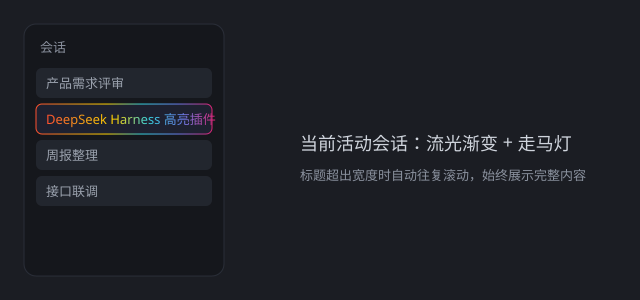

# Session highlight

给左侧会话列表中当前活动会话的名字加上不停滑动的彩色流光渐变，并让过长的标题走马灯滚动，始终展示完整内容。

## 效果

- 当前活动会话的名字会显示持续流动的彩虹渐变（流光溢彩）。
- 标题过长被截断时，会自动左右往复滚动，完整显示标题文字。
- 鼠标悬停在该行时，交还给内置的悬停走马灯，避免动画冲突。
- 尊重系统的「减少动态效果」偏好：开启后渐变不再流动。

## 实现

这是一个纯 Web 客户端装饰插件。会话列表的标题没有对应的插槽可以注入，
因此插件通过稳定的 DOM/ARIA 结构选择器定位当前活动会话的标题元素
（`[role="treeitem"][aria-selected="true"]` 下的第二个子元素），
注入一段 CSS 动画实现流光渐变，并用 `requestAnimationFrame` 驱动
标题的 `scrollLeft` 实现走马灯滚动。

